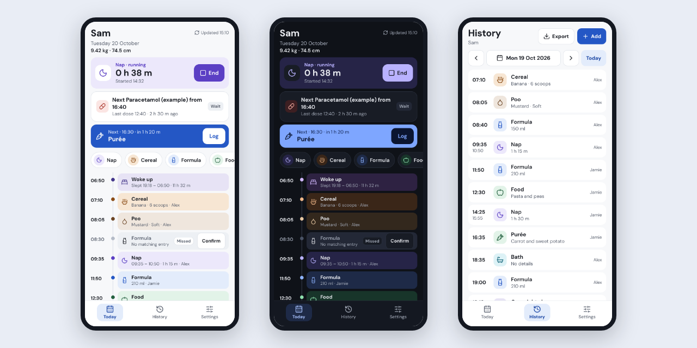
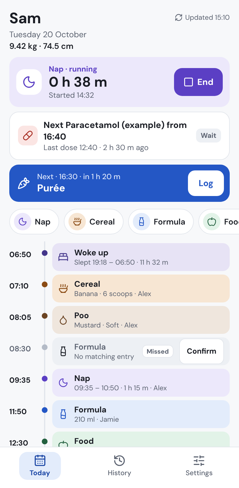
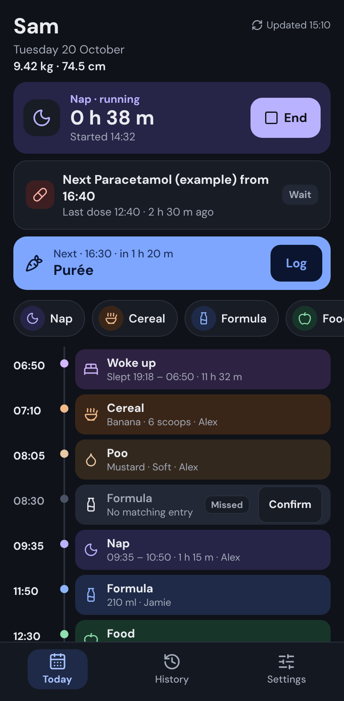
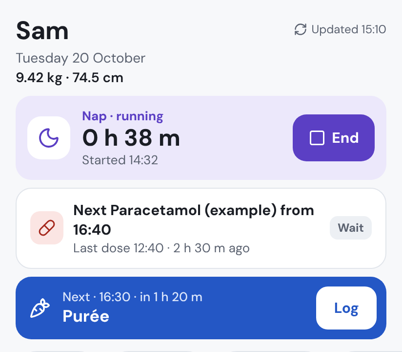
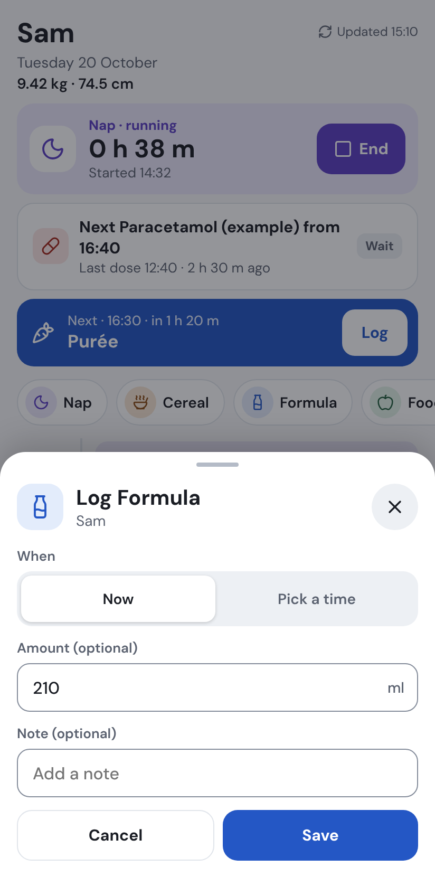
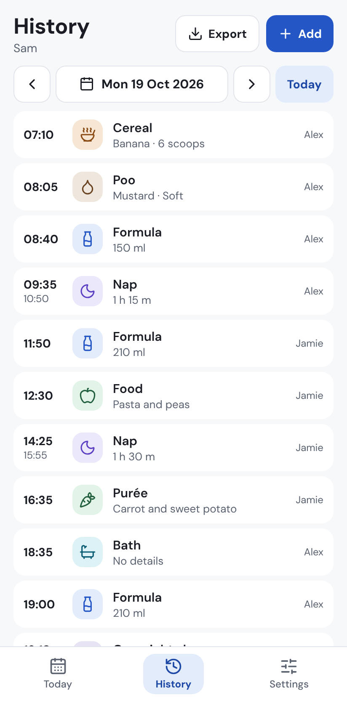
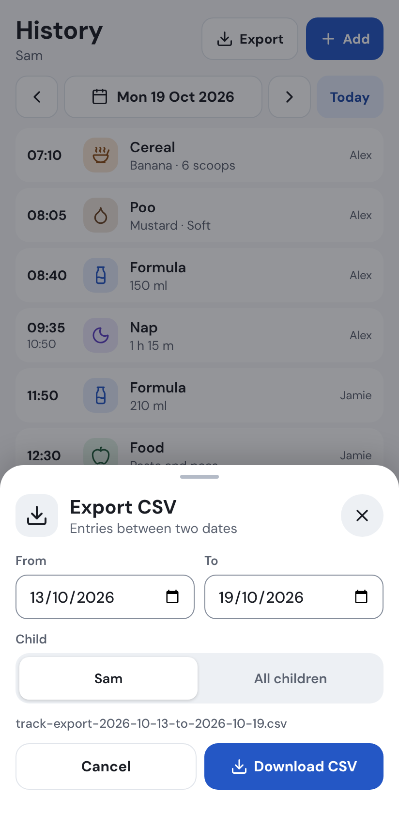
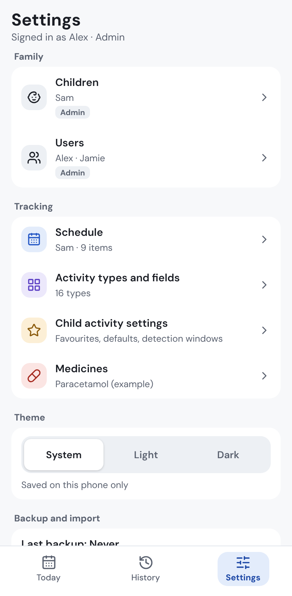
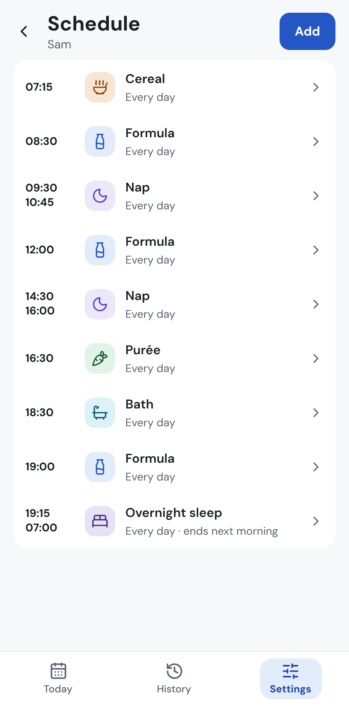
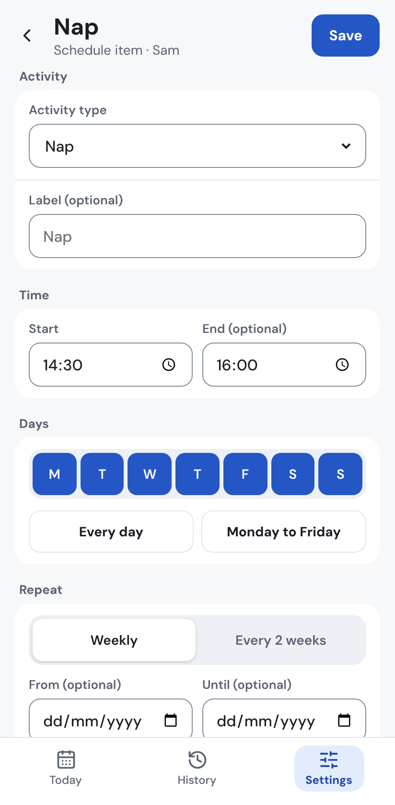

# Track

A private family activity tracker for babies and children.



## What it does

Track is an app you and your partner share to keep a simple record of your child's day.

- **Log the everyday things:** sleep, naps, feeds, food, nappies and medicine. One tap logs most things. You can also add something you forgot, at the time it happened.
- **A weekly routine:** set up what usually happens and when. Today's screen shows what's coming up next, and quietly marks anything that was missed.
- **Nap and sleep timers:** tap to start a nap, tap again when it ends.
- **A medicine timer:** shows when the next dose is allowed. It uses the gaps and daily limits that you enter yourself, from the packaging or your doctor or pharmacist.
- **Weight and height:** the latest values show next to your child's name.
- **More than one child:** switch between children with one tap.
- **Shared between parents:** everyone signs in with their own email. There are three roles:
  - **Admin** can do everything, including adding people and children.
  - **Writer** can log and change things.
  - **Read only** can look but not change anything. Good for grandparents.
- **History, export and backups:** look back at any day, export a spreadsheet (CSV file) for any dates, and download a full backup.
- **Light and dark mode**, or follow your phone's setting.
- **Works offline for viewing:** the last week stays on your phone, so you can check it without signal.
- **Grows with your child:** add nursery, school, clubs, or your own activity types with their own fields, and turn off the ones you no longer need.

## Screenshots

These use made-up demo data.

|                                                              |                                                      |                                                                                            |
| :----------------------------------------------------------: | :--------------------------------------------------: | :----------------------------------------------------------------------------------------: |
|         |   |  |
| **Today**: what's happened, what's next, and anything missed |                    **Dark mode**                     |              **Timers:** a nap in progress, and when the next dose is allowed              |
|             |  |                                        |
|        **Logging** a feed, now or at an earlier time         |         **History:** any day, one at a time          |                           **Export** a spreadsheet for any dates                           |
|                    |  |                      |
|                         **Settings**                         |        **The weekly routine** for each child         |                     **Editing** a routine item: times, days and dates                      |

## Good to know

- **Built for Android phones.** Track is a web app you install from Chrome: you add it to your home screen, and it opens like any other app. This is called a PWA (progressive web app). There's no app store involved.
- **Tested on Pixel phones** (Pixel 7 and Pixel 6a). It also works in a desktop browser. It isn't designed for iPhone.
- **Each family runs its own private copy.** There is no shared Track service. Your data lives in your own Cloudflare account, and nobody else can see it.
- **Only people you approve can sign in.** Cloudflare Access (a sign-in gate that sits in front of the app) checks each person's email before they get anywhere near the app. The app then checks again against its own list of users.
- **Cost.** Track runs on Cloudflare's free plan for normal family use. You'll need your own domain name (a web address such as `yourfamily.com`), which costs a small yearly fee.

## Set up with Claude (recommended)

The easiest way to set up Track is to let Claude guide you. Claude can explain each step, tell you where to click, and keep track of the codes you'll need. The final step, the deployment (putting the app online), uses Claude Code, so you'll need a Claude plan that includes Claude Code.

Copy this into a new chat with Claude:

```
I'd like to set up Track, a free, self-hosted family activity tracker, for my family. The code is at https://github.com/Ross-Stone/Website-Track-Public

Please:
1. Read the README and docs/claude-code-deploy-prompt.md in that repository.
2. Explain in plain English what I'll end up with, which accounts I need and what it might cost.
3. Walk me through the preparation one step at a time, waiting for me to confirm each step before moving on: a GitHub account, a Cloudflare account, a domain on Cloudflare, two D1 databases, a Cloudflare API token, Cloudflare Zero Trust login methods and Access applications (including the bypass for the app icons so it can be installed). Tell me exactly where to click. Keep a running list of the values I give you, such as database IDs and AUD tags. Never ask me to paste an API token into this chat.
4. When everything is ready, fill in the prompt from docs/claude-code-deploy-prompt.md with my values and give it to me to paste into Claude Code. Explain how to start Claude Code and where the API token goes.

I'm not very technical, so please avoid jargon and check I'm happy before moving on.
```

## Set up yourself

These are the same steps Claude would guide you through. Take your time: it's about an hour, and you only do it once.

You'll set up two copies of the app:

- **Production:** the one your family uses every day, for example `track.yourfamily.com`.
- **Preview:** a test copy, for example `track-preview.yourfamily.com`, where changes can be tried before they reach your family's copy.

Keep a note of the values you collect along the way. You'll need them in step 6.

### 1. Accounts you need

- **GitHub** (free), at [github.com](https://github.com). GitHub stores your copy of the code and puts it online for you.
- **Cloudflare** (free), at [cloudflare.com](https://www.cloudflare.com). Cloudflare runs the app and stores your data.
- **A domain on Cloudflare.** If you don't have a domain, you can buy one in the Cloudflare dashboard under **Domain Registration**. If you already have one elsewhere, add it to Cloudflare (**Add a domain**) and follow the steps to point it at Cloudflare.

### 2. Make your own private copy

1. Open [this repository](https://github.com/Ross-Stone/Website-Track-Public) on GitHub, signed in.
2. Click **Use this template** › **Create a new repository**.
3. Give it a name (for example `track`), choose **Private**, and click **Create repository**.

Make it **private**. Your copy will hold your web address and settings. A private copy also means nobody else can trigger anything from it.

### 3. Create the two databases

Track uses Cloudflare D1, a small database service.

1. In the Cloudflare dashboard, go to **Storage & databases** › **D1 SQL database** › **Create database**.
2. Create one called exactly `track-prod`.
3. Create a second one called exactly `track-preview`.
4. Open each one and copy its **Database ID** (a long code with dashes). Note which is which.

### 4. Create the API token

An API token is a password that lets GitHub put the app online in your Cloudflare account, and nothing more.

1. In the Cloudflare dashboard, click the profile icon (top right) › **Profile** › **API Tokens** › **Create Token**.
2. Next to **Edit Cloudflare Workers**, click **Use template**.
3. Under **Permissions**, keep what the template adds, and add these three rows:
   - **Account** › **D1** › **Edit**
   - **Zone** › **Workers Routes** › **Edit**
   - **Zone** › **DNS** › **Edit**
4. Under **Account Resources**, choose your account. Under **Zone Resources**, choose your domain.
5. Don't add any Access or Zero Trust permissions. The token doesn't need them.
6. Click **Continue to summary** › **Create Token**, and copy the token. You won't see it again. Keep it somewhere safe, such as a password manager, and never paste it into a chat.

Also note your **Account ID**. It's on the right-hand side of your domain's **Overview** page in the dashboard, or under **Account home** › **⋯** › **Copy account ID**.

### 5. Set up sign-in (Cloudflare Zero Trust)

Cloudflare Access puts a sign-in page in front of the app, so only your family can reach it. It's part of Cloudflare Zero Trust, which is free for up to 50 users.

1. **Team name.** In the Cloudflare dashboard, open **Zero Trust**. The first time, it asks you to choose a team name (for example `yourfamily`) and a plan: choose the **Free** plan. Your team domain is then `yourfamily.cloudflareaccess.com`. You can find it again under **Settings** in Zero Trust.
2. **Login methods.** Go to **Settings** › **Authentication** › **Login methods** › **Add new**. Add **One-time PIN** (a code sent by email; works with any email address). If your family uses Google accounts, you can also add **Google** (it needs a few extra steps, which the page explains).
3. **The production app.** Go to **Access** › **Applications** › **Add an application** › **Self-hosted**.
   - **Application name:** `Track`.
   - **Session duration:** **1 month**, so nobody has to sign in every day.
   - **Application domain:** your production address, for example `track.yourfamily.com`, with the path left empty.
   - **Policy:** name it `Family`, action **Allow**. Under **Include**, choose **Emails** and enter each family member's email address.
   - Tick the login methods you set up, then save.
4. **The icon bypass.** Phones need to fetch the app's name and icon before anyone signs in, to install it. Add a second **Self-hosted** application:
   - **Application name:** `Track icons`.
   - **Application domain:** the same address, with path `manifest.webmanifest`. Click **Add domain** and add the same address again, with path `icons/*`.
   - **Policy:** name it `Public icons`, action **Bypass**, and under **Include** choose **Everyone**.
   - Only these two paths go in this application. Everything else stays behind the sign-in.
5. **Repeat steps 3 and 4 for the preview address** (for example `track-preview.yourfamily.com`), naming them `Track preview` and `Track preview icons`.
6. **The AUD tags.** Open the `Track` application and find the **Application Audience (AUD) Tag** (a long code). Note it as the production AUD. Do the same for `Track preview`: that's the preview AUD. You don't need the AUD tags of the two icon applications.

### 6. Fill in the placeholders

In your private copy on GitHub, open `wrangler.jsonc`, click the pencil icon (**Edit this file**), and replace these values. They're all in this one file.

| Placeholder                              | Replace with                                                     | Where you got it       |
| ---------------------------------------- | ---------------------------------------------------------------- | ---------------------- |
| `track.example.com`                      | Your production address, for example `track.yourfamily.com`      | You choose it (step 5) |
| `track-preview.example.com`              | Your preview address, for example `track-preview.yourfamily.com` | You choose it (step 5) |
| `REPLACE_WITH_TEAM_NAME` (appears twice) | Your Zero Trust team name, for example `yourfamily`              | Step 5.1               |
| `REPLACE_WITH_PROD_ACCESS_AUD`           | The AUD tag of the `Track` application                           | Step 5.6               |
| `REPLACE_WITH_PREVIEW_ACCESS_AUD`        | The AUD tag of the `Track preview` application                   | Step 5.6               |
| `REPLACE_WITH_PROD_D1_ID`                | The Database ID of `track-prod`                                  | Step 3                 |
| `REPLACE_WITH_PREVIEW_D1_ID`             | The Database ID of `track-preview`                               | Step 3                 |

Keep everything else as it is, including the names `track`, `track-preview` and `track-prod`. Then click **Commit changes**.

These values aren't passwords, but they're specific to your family. That's one more reason your copy should be private.

### 7. GitHub secrets and variables

In your private copy on GitHub, go to **Settings** › **Secrets and variables** › **Actions**.

On the **Secrets** tab, click **New repository secret** for each of these. Secrets are hidden once saved.

| Secret                  | Value                                  |
| ----------------------- | -------------------------------------- |
| `CLOUDFLARE_API_TOKEN`  | The API token from step 4              |
| `CLOUDFLARE_ACCOUNT_ID` | Your Cloudflare Account ID from step 4 |

On the **Variables** tab, click **New repository variable** for each of these:

| Variable         | Value                                                                                                       |
| ---------------- | ----------------------------------------------------------------------------------------------------------- |
| `ADMIN_EMAIL`    | The email of the first Admin (probably you). It must also be in the Access policy.                          |
| `DEPLOY_ENABLED` | `true`. Without it, nothing is ever deployed.                                                               |
| `PREVIEW_URL`    | Optional. Your preview address, for example `https://track-preview.yourfamily.com`, shown on pull requests. |

### 8. Deploy

GitHub Actions (GitHub's built-in automation) puts the app online for you:

- **Production:** every change to the `main` branch deploys production. To deploy for the first time, go to the **Actions** tab, click **Deploy production** on the left, then **Run workflow** › **Run workflow**.
- **Preview:** every pull request (a proposed change) deploys the preview copy first, so you can try it before it reaches your family.

Each deploy runs the tests first. If anything fails, nothing changes. The first deploy also creates the web address records for your domain, and adds `ADMIN_EMAIL` as the Admin.

Don't also connect the repository in Cloudflare's dashboard (Workers Builds). GitHub Actions does all the deploying.

### 9. First sign-in

1. Open your production address. Cloudflare asks for your email and sends a code (or lets you sign in with Google).
2. Track opens. You'll see **No children yet**.
3. Go to **Settings** › **Children** and add your child's first name.
4. In **Settings**, set up the **Schedule** (routine), **Medicines** and **Child activity settings** (quick log favourites and default amounts) when you're ready.
5. **Add other people** in **Settings** › **Users**, choosing **Writer** or **Read only**. Also add their email to the `Family` policy in Cloudflare Access (step 5.3), or they won't get past the sign-in page. Both are needed.

### 10. Install on Android

1. Open your production address in **Chrome** and sign in.
2. Tap **Install app** if Chrome offers it, or tap **⋮** › **Add to Home screen** › **Install**.

Track then opens from your home screen like any other app.

### 11. Backups

Go to **Settings** › **Backup and import** › **Download backup** every week or so, and keep the file somewhere safe, such as your cloud storage. Cloudflare can only undo changes from the last 7 days, so these backups are your long-term safety net. Settings shows when you last took one.

### 12. Getting updates later

When this public repository gets improvements, you can bring them into your private copy. The easiest way is to ask Claude Code, in your copy: _"Bring in the latest changes from https://github.com/Ross-Stone/Website-Track-Public, keep my values in wrangler.jsonc, and open a pull request."_ The pull request deploys to preview first, so you can check it before merging it into `main`.

If you prefer to do it yourself, add this repository as a second remote and merge its `main` branch. The first time, add `--allow-unrelated-histories`, because a template copy starts with its own history. Keep your own values in `wrangler.jsonc` if there's a conflict.

## Important

Track records what you enter and does simple time arithmetic. **It gives no medical advice.** All doses, gaps and limits come from what you type into Settings. Always follow the medicine packaging or your doctor or pharmacist.

## Built with

- [React](https://react.dev) and [Vite](https://vite.dev) for the app
- [Hono](https://hono.dev) for the server code
- [Cloudflare Workers](https://developers.cloudflare.com/workers/) to run it, [D1](https://developers.cloudflare.com/d1/) to store the data, and [Cloudflare Access](https://developers.cloudflare.com/cloudflare-one/policies/access/) for sign-in
- [Lucide](https://lucide.dev) icons and the DM Sans font, both bundled with the app (nothing loads from other sites)

Track was designed and built with [Claude](https://claude.ai).

### For developers

- Requirements: [`docs/requirements.md`](docs/requirements.md). Implementation notes: [`docs/implementation-plan.md`](docs/implementation-plan.md). Conventions and rules: [`CLAUDE.md`](CLAUDE.md).
- You need Node 24 (see `.nvmrc`). Then:

  ```sh
  npm ci
  cp .dev.vars.example .dev.vars   # turns on the local-only sign-in stub
  npm run db:migrate:local         # creates the local database
  npm run seed:demo                # optional: the fictional demo family (Alex, Jamie and Sam)
  npm run dev                      # http://localhost:5173
  ```

  Instead of the demo family, `npm run db:admin:local` makes `DEV_AUTH_EMAIL` from `.dev.vars` the Admin of an empty local database.

- `npm run check` runs the type-check, lint, formatting, unit and Worker tests and the build. `npm run e2e` runs the Playwright tests. `npm run screenshots` regenerates the screenshots above.
- The local sign-in stub only works on `localhost`, and never when Access is configured. Deployed copies always use Cloudflare Access.
- The CI workflow runs the checks on every push and pull request. The deploy workflows only run when `DEPLOY_ENABLED` is `true` and the secrets exist.
- **Refresh preview from production** (Actions tab, run by hand, with a typed confirmation) replaces all preview data with a copy of production. It only ever reads production. Remember that preview then holds your real family data.

## Licence

MIT. See [LICENSE](LICENSE).
